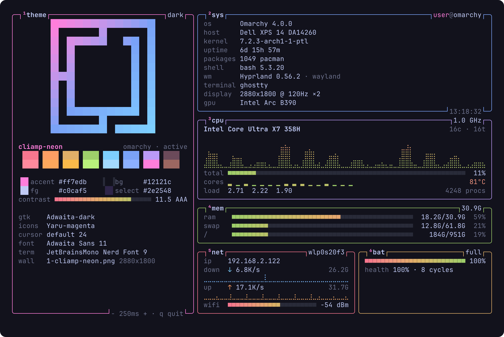
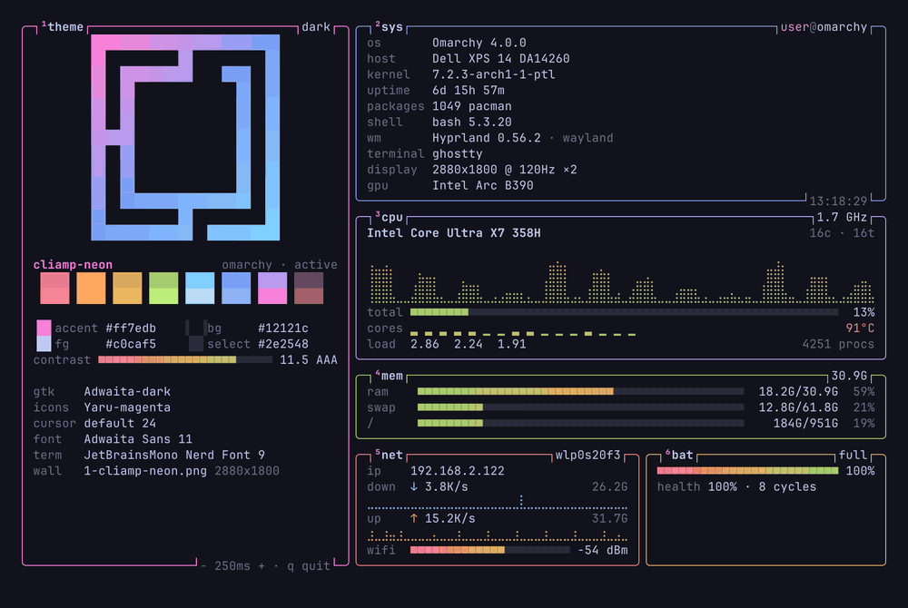

# pixeltop



`pixeltop` is a live system monitor for the terminal that puts your theme first. It shows the Omarchy logo in your theme colors, your palette with contrast grades, and your desktop settings. Beside the theme, it shows system data in rounded boxes with gradient meters and braille graphs, in the style of btop. The dashboard refreshes on an interval.

## Demo



In this 10-second demo, the active Omarchy theme changes twice: from `cliamp-neon` to `catppuccin-latte`, then to `gruvbox`. The dashboard reloads the colors on the next refresh. For the full resolution, open [`assets/demo.mp4`](assets/demo.mp4).

## Views

| Command | What it shows |
| --- | --- |
| `pixeltop` | The live dashboard: theme, system, cpu, memory, network and battery. It refreshes on every interval |
| `pixeltop --once` | One snapshot of the dashboard, for example in your shell startup file |
| `pixeltop palette` | Every theme color with hex values, WCAG contrast on the background, and a code and terminal preview |
| `pixeltop themes [text]` | A gallery of the installed Omarchy themes. Each card uses the colors and wallpaper of its theme |

## Keys in the dashboard

| Key | Action |
| --- | --- |
| `+` | Make the refresh interval 250 ms longer |
| `-` | Make the refresh interval 250 ms shorter. The minimum is 250 ms |
| `q`, `Esc` or `Ctrl+C` | Quit |

## Small screens and small devices

The dashboard adapts to the terminal size, so it also works in a small tiled window, on a phone over SSH, and on a board such as a Raspberry Pi.

- **Width:** Below 100 columns, the dashboard collapses to one column with one box per row. From 100 columns, the theme gets its own column. From 140 and 200 columns, a wide and short window gets three or four columns.
- **Short terminals:** From 90 columns, a short terminal such as a phone in landscape gets two columns when one column would have to drop about two boxes.
- **Height:** Each column gives up detail until it fits. It removes graph rows first, then it makes the logo smaller and removes system rows. It removes whole boxes last, and never cuts a box in half.
- **Narrow boxes:** Boxes use short labels and short color names, so that the values keep their room.
- **Minimum:** The dashboard needs 24 columns and 6 rows. A smaller terminal shows a message.
- **Bandwidth:** The live view sends only the lines that changed, without repeated color codes. This cuts the output about 4 times, which helps over SSH and on slow terminals.
- **ARM boards:** `pixeltop` names ARM cores from their part number, for example `Cortex-A72`, and reads the board name from the device tree.
- **Android:** Android hides CPU times from apps such as Termux. The cpu box then shows `usage not available` instead of a false 0%.

The `palette` view also collapses: below 59 columns, each color takes two rows. The `themes` gallery shows fewer cards in each row.

## Install

`pixeltop` runs on Linux. It is made for Omarchy, and it also works on other Linux systems.

To install the release binary, download `pixeltop-0.1.0-linux-amd64.tar.gz` from the [latest release](../../releases/latest). Then run:

```sh
tar -xzf pixeltop-0.1.0-linux-amd64.tar.gz
install -Dm755 pixeltop-0.1.0-linux-amd64/pixeltop ~/.local/bin/pixeltop
```

## Build from source

Building needs Go 1.26 or later.

```sh
make build      # builds ./pixeltop
make install    # copies it to ~/.local/bin
make test       # runs the tests
make release    # writes dist/pixeltop-VERSION-linux-amd64.tar.gz and SHA256SUMS
```

To use another Go command, set `GO`. For example: `make build GO="mise exec go@1.27.1 -- go"`.

## Usage

```sh
pixeltop                                  # live dashboard for the active theme
pixeltop -i 500                           # refresh every 500 ms
pixeltop --once                           # print one snapshot and exit
pixeltop --theme tokyo-night              # preview an installed theme
pixeltop --theme ./colors.toml            # watch a theme file while you edit it
pixeltop palette --theme kanagawa         # all colors of a theme
pixeltop themes kanagawa                  # gallery, filtered by name
```

| Flag | Effect |
| --- | --- |
| `-t`, `--theme NAME` | Use an installed theme, a theme folder, or a color file |
| `-i`, `--interval MS` | Set the refresh interval. The default is 1000 |
| `-1`, `--once` | Print one snapshot of the dashboard and exit |
| `-w`, `--width N` | Set the output width. The default is the terminal width |
| `--color MODE` | Set the color output: `auto`, `truecolor`, `256` or `none` |
| `--bg` | Paint the theme background behind the output |
| `--no-bg` | Never paint the theme background |
| `--no-logo` | Hide the Omarchy logo |

When the output is not a terminal, `pixeltop` prints one snapshot. For example, `pixeltop | less -R` shows a snapshot.

A preview of a theme that is not active paints the background of that theme. The colors then look as they do on a desktop that uses the theme. To turn this off, use `--no-bg`.

## Theme sources

`pixeltop` uses the first source that it finds:

1. The active Omarchy theme in `~/.local/state/omarchy/current/theme`.
2. The 16 colors, foreground and background that the terminal reports through OSC 4, 10 and 11.
3. The built-in `pixeltop` palette.

The `--theme` flag reads these files, in this order: `colors.toml`, `alacritty.toml`, `kitty.conf` and `ghostty.conf`. A theme name is looked up in `~/.config/omarchy/themes` and then in `$OMARCHY_PATH/themes`.

The dashboard reloads the theme on each refresh when one of these changes:

- The active Omarchy theme or its wallpaper.
- The color file of the theme. Use this to watch a `colors.toml` while you edit it.

Missing keys in `colors.toml` get the same fallback values as `omarchy-theme-color` gives them. For example, `orange` falls back to `yellow`, and each `bright_*` color is the base color mixed with 20% white. The palette view thus shows the colors that Omarchy writes into your app configs.

## Logo and wallpapers

The dashboard draws the Omarchy mark from `icon.txt` in the Omarchy repository. The mark sits on a 13 by 13 grid. `pixeltop` draws each logo pixel as two cells, and uses half blocks when space is short. A diagonal gradient from the accent color to cyan colors the logo.

The `themes` gallery shows each wallpaper as half-block pixels. `pixeltop` decodes PNG, JPEG, GIF and WebP files, crops them to 16:9 and averages them down. Decoding a large wallpaper is slow, so `pixeltop` caches each thumbnail in `~/.cache/pixeltop/thumbs`. The first gallery run takes about 2 seconds. Later runs read the cache.

## Colors

`pixeltop` uses 24-bit color by default. It uses 256 colors when `TERM` is `linux` or the terminal is Apple Terminal. It prints plain text when `NO_COLOR` is set.

## Data sources

All system data comes from `/proc`, `/sys` and `/etc/os-release`. `pixeltop` runs four short commands when they exist: `hyprctl` for the Hyprland version and monitors, `gsettings` for GTK settings, `fc-match` for the monospace font, and your shell for its version. Each command has a 600 ms timeout. The live dashboard runs `gsettings` again every 5 refreshes, and `hyprctl` every 30 refreshes.
